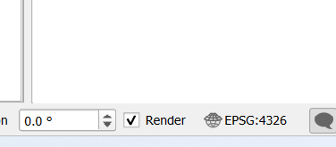

# Week 4 — Acquisition and integration gate

## Decision framing

1. **Decision-maker:** The GIS data steward is responsible for deciding whether
   the supplied spatial data can enter a limited integration and planning
   check.
2. **Possible action:** Permit a limited, fictional planning check using
   `facility_points` while keeping `legacy_access_paths` quarantined until its
   provenance, licence, metadata, and missing geometries are resolved.
3. **Spatial unit:** The analysis uses facility locations as points and
   service zones as polygons. The supplied layers contain five facilities and
   three service zones.
4. **Geographic extent:** The full service-zone extent is approximately
   longitude -113.815 to -113.764 and latitude 52.235 to 52.262. The extent
   must be confirmed against the layers in the prepared QGIS project.
5. **Appropriate scale:** Use a local map at approximately 1:25,000 to show
   all three service zones and five facilities. Confirm the scale and
   coordinate reference system in the final QGIS layout.
6. **Time limitation:** The records are a deterministic synthetic snapshot
   generated on 2026-08-13, not a live operational export. They cannot
   establish current facility conditions.
7. **Integration decision:** `conditional`.
8. **Scope limitation:** This decision applies only to the fictional course
   dataset. It is not an authorization for a real operational decision or for
   substituting real personal, sensitive, community, or Indigenous data.

## Initial evidence

The source inventory marks `facility_points` as ready, with a stated CC0-1.0
licence and no missing geometry. It marks `legacy_access_paths` for
quarantine; its licence and source details are unknown, and two geometries
are missing. The inventory also omits the supplied `service_zones` layer, so
its source-specific provenance is not recorded there. The limited decision
above depends on keeping `legacy_access_paths` quarantined and resolving the
service-zone inventory gap rather than treating every supplied layer as
integration-ready.

The supplied metadata identifies EPSG:4326 as the storage CRS and EPSG:32612
as the suggested analysis CRS when metric distance or area is required. The
analysis CRS, its units, and its area of use must be checked before using it.

## QGIS checks — Part A

The original project and layers opened without missing-layer warnings. The
GeoJSON layers had no CRS assigned in QGIS, so EPSG:4326 was assigned from the
supplied metadata; the coordinates were not reprojected. The project CRS is
displayed as EPSG:4326 in QGIS (see the evidence image below). The supplied
`qgis-project.qgz` was preserved.

The `facilities` layer contains five Point features. `feature_id` is the
stable ID field, and the five IDs were checked for uniqueness and blank
values. The `service_zones` layer contains three Polygon features.
`feature_id` is its stable ID field; the zone IDs are unique and populated,
and no `zone_name` values were blank.

The QGIS Check Validity operation was run on `service_zones` using the GEOS
method. It returned three valid and zero invalid geometries. A derived copy of
the valid output was saved as `outputs/service_zones_valid.gpkg`; the source
GeoJSON was not changed.

## Reproducible integration check — Part A

QGIS Processing **Join attributes by location** was run with `facilities` as
the input and `service_zones` as the join layer. The join method was one-to-one
(first matching feature). With the `within` predicate, the five input
facilities each received one non-empty service-zone name. The output was saved
to `outputs/facility_zone_within.gpkg`.

The same operation was repeated with only the predicate changed to
`intersects`; its output was saved to `outputs/facility_zone_intersects.gpkg`.
Both runs returned five facilities with the same zone assignments, so no
facility IDs were affected. The comparison is recorded in
`outputs/changed-variable-comparison.csv`. This result supports the limited
fictional planning check only; it does not resolve the quarantined legacy
source or the missing source-inventory record for `service_zones`.